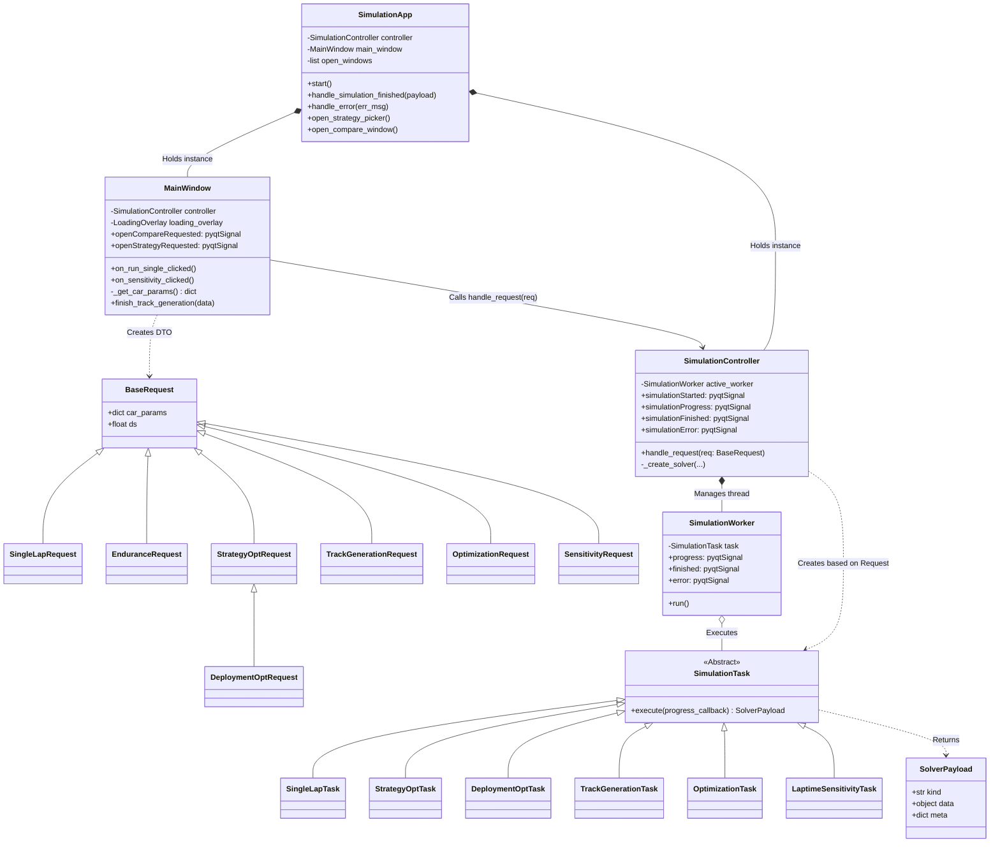
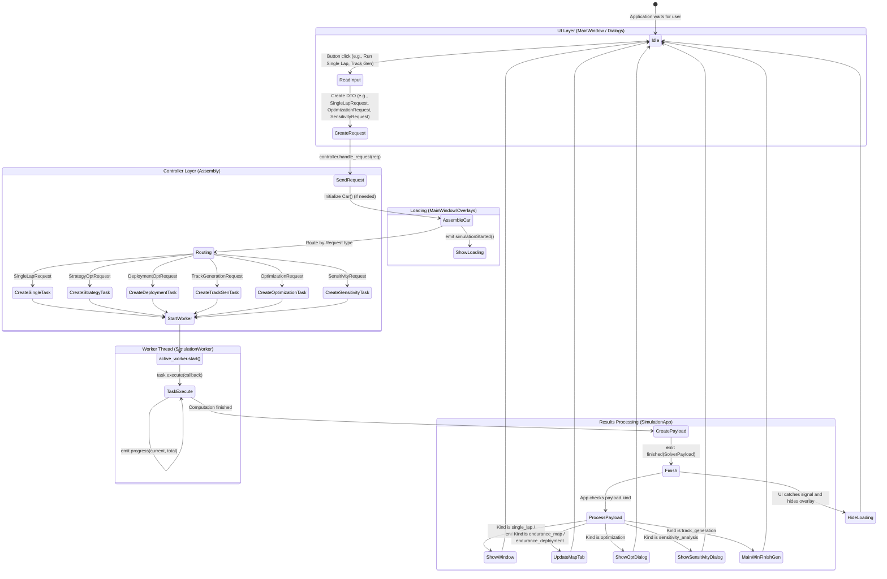

# Laptime simulator & strategy optimizer

## Installation

1. **Clone the repository**:
   ```bash
   git clone <repository_url>
   cd optiSim
   ```

2. **Set up a virtual environment (Optional but recommended)**:
   ```bash
   python -m venv venv
   # On Windows:
   venv\Scripts\activate
   # On macOS/Linux:
   source venv/bin/activate
   ```

3. **Install the dependencies**:
   ```bash
   pip install -r requirements.txt
   ```

## Usage

### Running the Main GUI

To launch the primary graphical user interface:

```bash
python main.py
```

### Running standalone sweep scripts

You can bypass the UI and call the simulation from a python script. See the `utils/` directory for examples.  

For example, to generate a mass vs. CD sensitivity grid:
```bash
python utils/run_mass_cd_grid.py
```

To generate a full battery endurance grid for the strategy optimizer:
```bash
python utils/run_battery_laptime_grid.py
```


## Architecture


### 1. Class diagram



### 2. State diagram 


